# ИИ Методист

**Сайт проекта:** [www.hwstud.ru](https://www.hwstud.ru)

**Репозиторий GitHub:** [github.com/PAUL-V-STEP/hwstud](https://github.com/PAUL-V-STEP/hwstud)

«ИИ Методист» (техническое имя репозитория — `hwstud`) — веб-платформа учебного курса с лекциями, домашними заданиями, предварительной проверкой ИИ и обязательным решением преподавателя. Проект рассчитан на одного преподавателя и четыре группы студентов — до 20 человек в группе.

Основное приложение находится в [`hwstud-claude/`](hwstud-claude/). Интерфейс и документация — на русском языке.

> Скриншоты ниже созданы на изолированной демонстрационной базе. Все ники, работы, сообщения и результаты условны; реальные данные студентов и секреты не использовались.

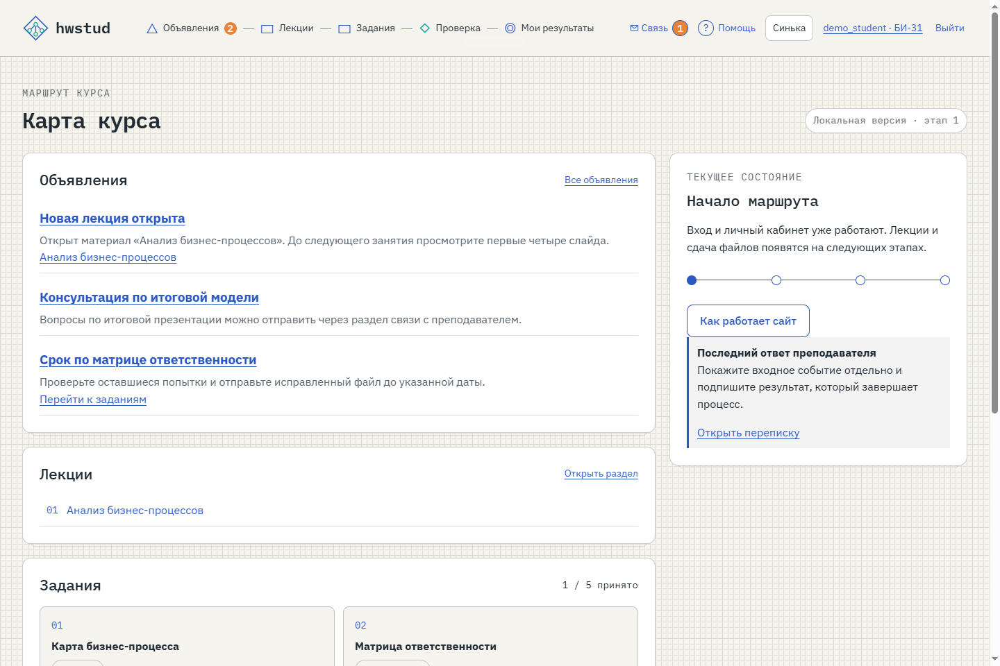

## Возможности

### Для студента

- просмотр лекций в режимах «Слайд + текст» и «Конспект»;
- глоссарий, литература, ссылки на источники и выгрузки;
- загрузка работ в PDF, JPG, PNG, TXT и DOCX с проверкой ограничений;
- четыре попытки на задание, понятные статусы и комментарий после решения преподавателя;
- результаты, обезличенное распределение баллов и личный SWOT;
- объявления, переписка с преподавателем и диалоги разбора конкретной попытки;
- вход по нику и личному ключу без обязательных ФИО, почты и телефона.

### Для преподавателя

- импорт пары PPTX + PDF с предпросмотром и ручным открытием лекций группам;
- настройка заданий, критериев, сроков и порога уверенности ИИ;
- очередь проверки, ручное одобрение результата и выгрузка CSV;
- управление группами, никами, ключами и временными окнами регистрации;
- объявления, ответы студентам и режим экзамена;
- монитор ProxyAPI, очередь фоновых задач, резервные копии и удаление данных после курса.

### Технологии

| Слой | Решение |
|---|---|
| Backend | Python 3.12, FastAPI, uvicorn |
| Интерфейс | Jinja2, серверный HTML, локальные CSS и JavaScript |
| Данные | SQLite через `sqlite3`, SQL-миграции, режим WAL |
| Фоновая работа | Таблица `jobs`, `asyncio`, один процесс и один worker |
| Файлы | PyMuPDF, python-pptx, python-docx, Pillow, openpyxl |
| Внешние интеграции | ProxyAPI для ИИ и SMTP для уведомлений преподавателю |
| Production-контур | Caddy, systemd, Ubuntu 24.04 |
| Тестирование | pytest с временной SQLite и заглушками внешних сервисов |

## Экраны студента

| Лекции | Слайд и текст |
|---|---|
| [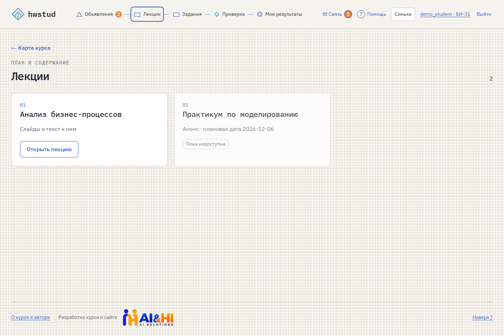](docs/images/02-student-lectures.png) | [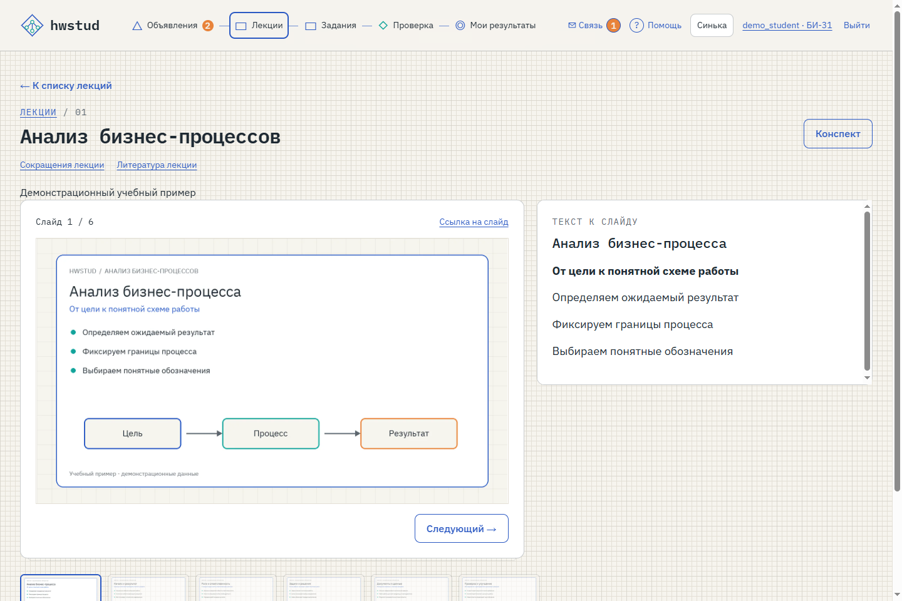](docs/images/03-student-lecture-slide.png) |
| **Задания** | **Результаты** |
| [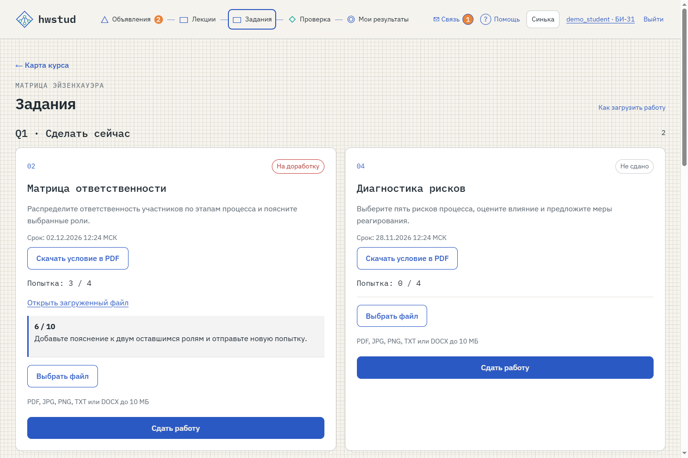](docs/images/04-student-assignments.png) | [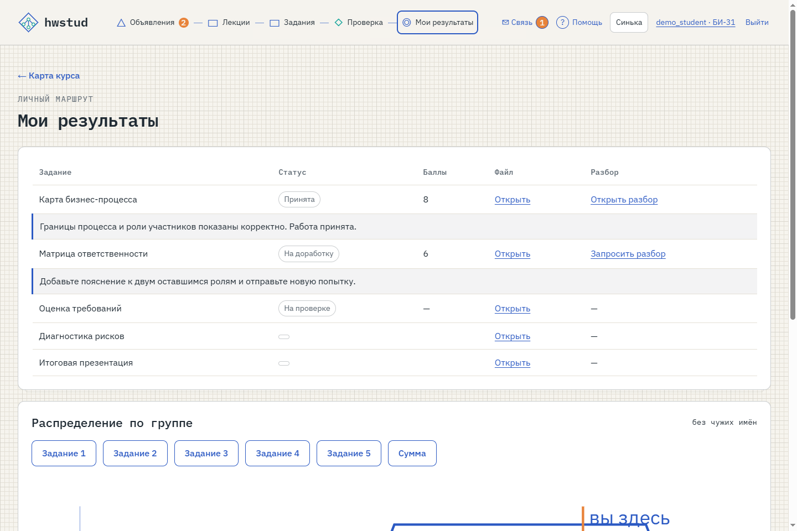](docs/images/05-student-results.png) |
| **Личный SWOT** | **Переписка** |
| [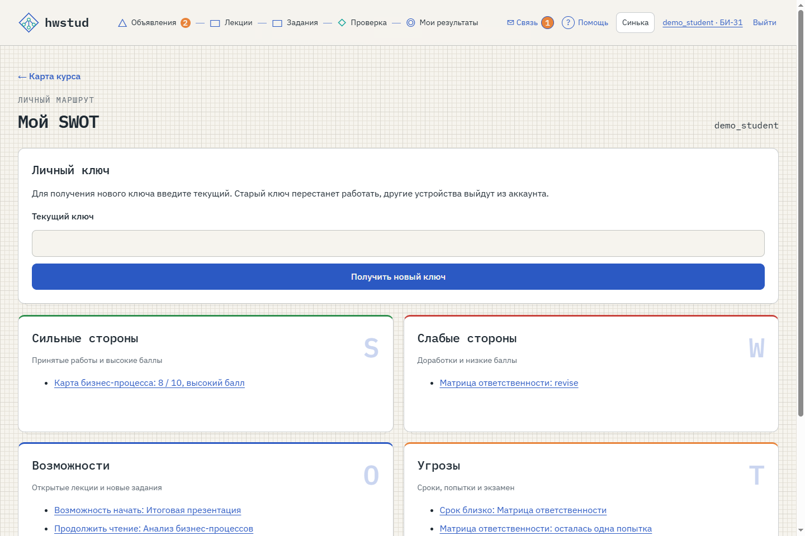](docs/images/06-student-cabinet.png) | [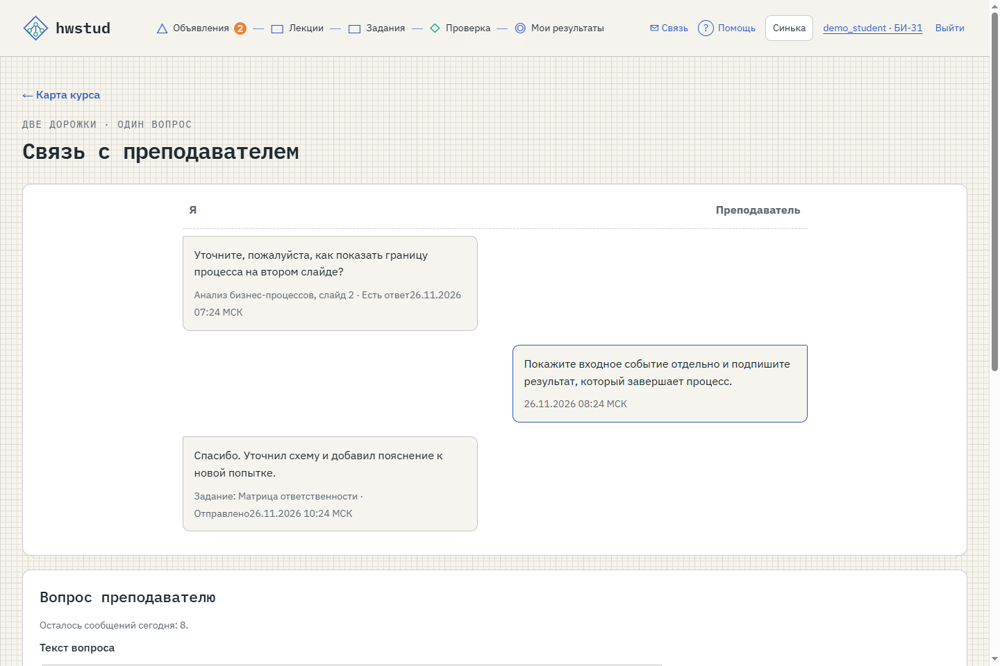](docs/images/07-student-messages.png) |

## Экраны преподавателя

| Панель управления | Лекции |
|---|---|
| [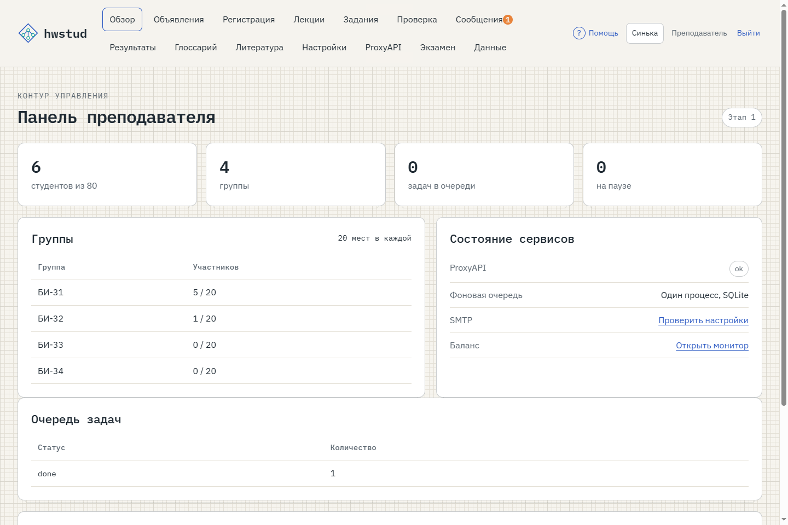](docs/images/08-admin-dashboard.png) | [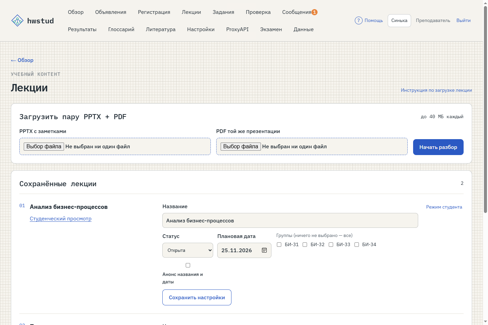](docs/images/09-admin-lectures.png) |
| **Проверка работ** | **Настройка заданий** |
| [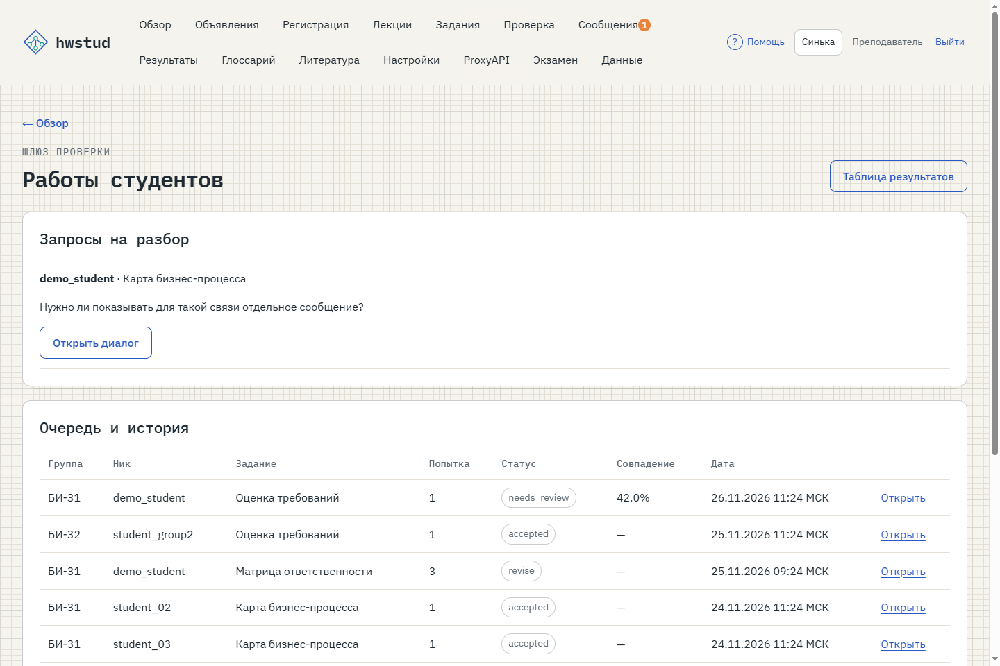](docs/images/10-admin-submissions.png) | [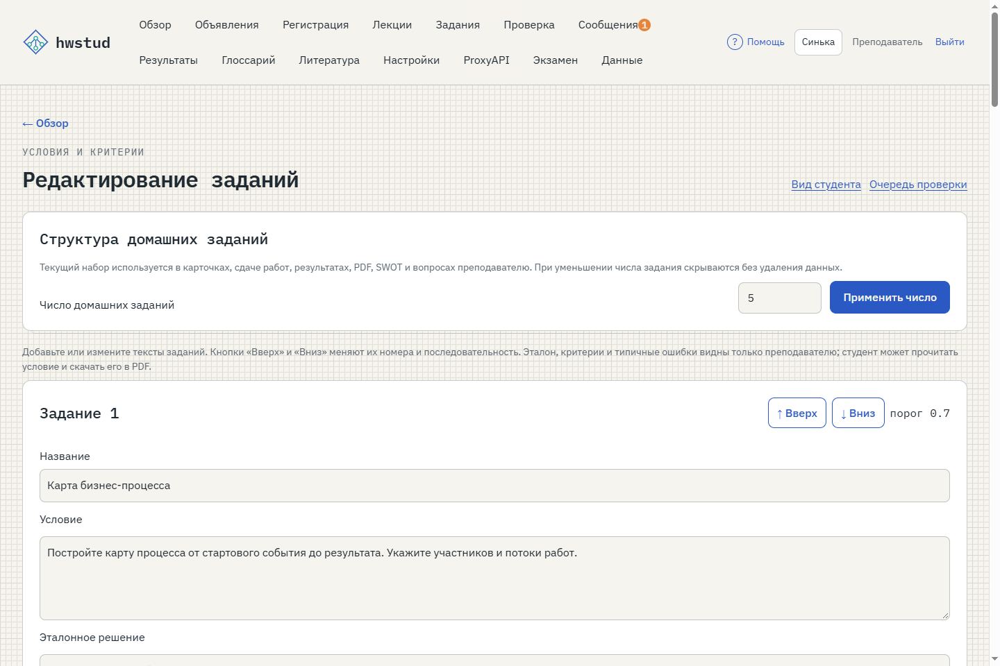](docs/images/11-admin-assignments.png) |
| **Результаты** | **Группы и студенты** |
| [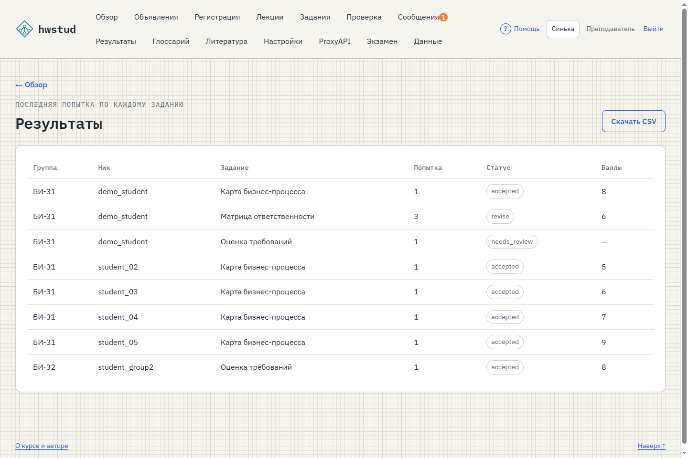](docs/images/12-admin-results.png) | [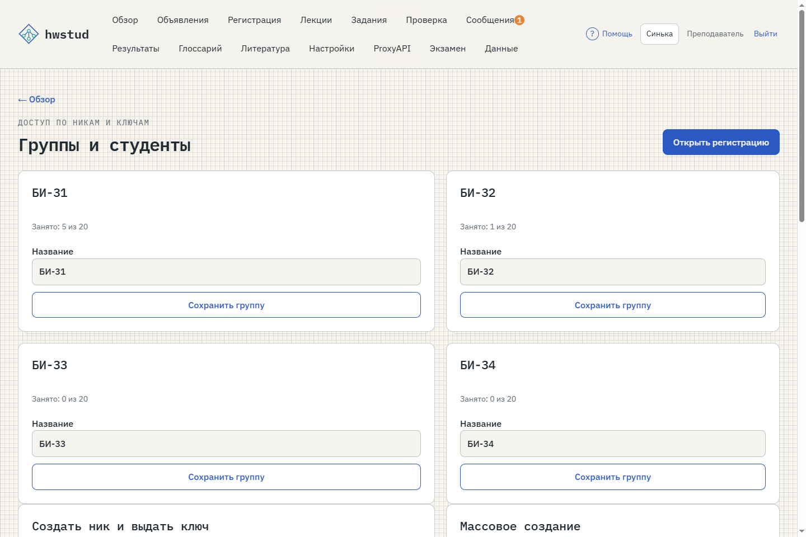](docs/images/13-admin-groups.png) |

## Локальный запуск на Windows

Нужен **Python 3.12**. Выполните команды из корня репозитория:

```powershell
cd hwstud-claude
py -3.12 -m venv .venv
.venv\Scripts\python.exe -m pip install -r requirements.txt
.venv\Scripts\python.exe -m app.tools.init_local
.venv\Scripts\python.exe -m uvicorn app.main:app --host 127.0.0.1 --port 8000 --workers 1
```

Откройте <http://127.0.0.1:8000>.

`init_local` создаёт локальный `.env` только при его отсутствии, генерирует секрет сессии без вывода в терминал, создаёт рабочие каталоги и применяет миграции. Существующий `.env` не перезаписывается.

Первичный вход преподавателя и обязательная смена пароля описаны в [README приложения](hwstud-claude/README.md#вход-преподавателя).

> Не используйте второй uvicorn worker: очередь, расписание, лимиты и временные карточки доступа рассчитаны на один процесс. Не публикуйте сайт с начальным паролем.

## Проверка

Из каталога `hwstud-claude/`:

```powershell
.venv\Scripts\python.exe -m pytest
```

Точечный запуск:

```powershell
.venv\Scripts\python.exe -m pytest tests\test_submissions.py
```

Автоматические тесты используют временную SQLite и заглушки ProxyAPI/SMTP. Внешние сетевые запросы не выполняются. Последняя локальная проверка 26.11.2026: **168 passed, 6 warnings**.

Реальная проверка моделей выполняется отдельно и может быть платной. Без явного подтверждения запускать её не нужно:

```powershell
.venv\Scripts\python.exe -m app.tools.check_models --confirm-paid
```

## Структура репозитория

```text
hwstud/
├── .claude/skills/hwstud/       # Skill Claude Code и его DOCX-версия
├── docs/images/                 # Скриншоты для этого README
├── hwstud-claude/
│   ├── app/
│   │   ├── routes/              # HTTP-маршруты по предметным областям
│   │   ├── services/            # Бизнес-логика, файлы, GPT, копии
│   │   ├── templates/           # Серверные Jinja2-шаблоны
│   │   ├── access.py            # Центральные правила доступа
│   │   ├── auth.py              # Сессии, вход, CSRF, scrypt
│   │   ├── db.py                # SQLite, транзакции и миграции
│   │   ├── main.py              # Создание FastAPI-приложения
│   │   └── worker.py            # Очередь и фоновое расписание
│   ├── migrations/              # Последовательные SQL-миграции
│   ├── static/                  # Локальные CSS, JS, шрифты, изображения
│   ├── tests/                   # Автоматические тесты
│   ├── deploy/                  # Caddy, systemd, production env example
│   ├── REQUIREMENTS.md          # Требования и критерии приёмки
│   ├── TESTING.md               # Фактические результаты проверок
│   └── DEPLOY.md                # Установка и восстановление
└── hwstud_analysis_and_development.docx
```

## Документация

- [README приложения](hwstud-claude/README.md) — статус, запуск и вход;
- [требования](hwstud-claude/REQUIREMENTS.md) — объём функций и критерии приёмки;
- [архитектура](hwstud-claude/docs/03-ARCHITECTURE.md) — стек, данные, очередь и интеграции;
- [дизайн](hwstud-claude/docs/02-DESIGN.md) — визуальные правила и экраны;
- [вход и регистрация](hwstud-claude/docs/07-AUTH-CLASS-CODE-KEYS.md);
- [установка на REG.RU](hwstud-claude/DEPLOY.md);
- [результаты проверок](hwstud-claude/TESTING.md);
- [анализ и дорожная карта развития](hwstud_analysis_and_development.docx).

## Claude Code

Проектный skill помогает разбираться в структуре, запускать сервис, изменять код, обновлять документацию, диагностировать ошибки и готовить выпуск:

- [SKILL.md](.claude/skills/hwstud/SKILL.md) — основная версия для Claude Code;
- [hwstud-skill.docx](.claude/skills/hwstud/hwstud-skill.docx) — версия для чтения и печати.

В новой сессии Claude Code можно вызвать skill командой `/hwstud` либо попросить выполнить задачу с использованием проектного skill hwstud.

## Данные и публикация

Файл `.env`, каталоги `.venv/` и `data/` исключены из Git. Не добавляйте в репозиторий рабочие базы, реальные работы студентов, секреты, пароли и открытые личные ключи.

Проект содержит реализацию основного учебного контура, но производственная установка не выполнялась. Linux/REG.RU, реальный SMTP, предельная память и восстановление на целевом сервере проверяются отдельно. Перед публикацией используйте release-checklist из проектного skill и [анализ текущих рисков](hwstud_analysis_and_development.docx).
